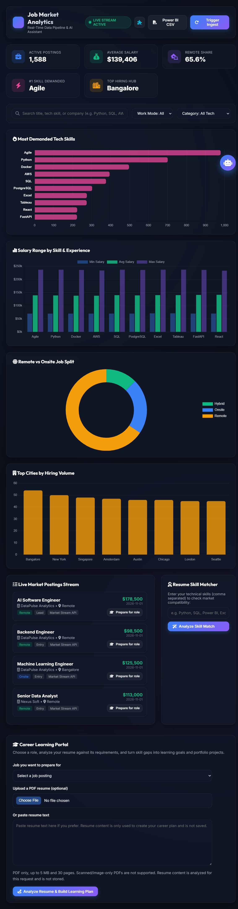

# Job Market Analytics Platform

An end-to-end job-market analytics application that collects job postings,
extracts in-demand skills, analyzes salary and location trends, and presents
those insights through an interactive dashboard and career tools.

## What it includes

- **Live analytics dashboard** with job volume, salary, work-mode, city, and
  skill-demand charts.
- **Job feed and filters** for searching postings by role, skill, company, and
  work mode.
- **Career Learning Portal** to compare a resume with a selected posting and
  turn skill gaps into learning goals and portfolio-project briefs. PDF resumes
  are limited to 5 MB and 30 pages, and their extracted text is not stored.
- **Extras workspace** with a role-based skill-gap analyzer, a salary model for
  postings without salary data, skill-demand forecasts, fresher insights,
  a city/remote opportunity map, and safe read-only SQL chat with a learning
  roadmap generator.
- **Job ingestion pipeline** that fetches postings from Remotive and Jobicy,
  transforms them, extracts skills, and stores them in SQLite. Synthetic
  postings can also be generated for demonstration.
- **Chat assistant** for job-market questions, plus CSV export for Power BI.

## Screenshots

### Main dashboard



### Extras workspace


### Skill-gap analysis


### Salary prediction


### City and remote opportunities


More feature details and screenshots are in the [extras guide](docs/extras/README.md).

## Technology

- **Backend:** Python, FastAPI
- **Data and analytics:** SQLite, SQL, Pandas, scikit-learn, statsmodels
- **Frontend:** HTML, CSS, JavaScript, Chart.js, Plotly
- **Testing:** pytest

## Clone and run locally

### Prerequisites

- Git
- Python 3.11 or newer
- Internet access for installing packages and fetching live job postings

### 1. Clone the repository

```shell
git clone https://github.com/Wincyveronika-21/end-to-end-job-market-analytics-platform.git
cd end-to-end-job-market-analytics-platform
```

### 2. Create and activate a virtual environment

**Windows PowerShell:**

```powershell
py -3.11 -m venv .venv
.\.venv\Scripts\Activate.ps1
```

If PowerShell blocks activation, allow it for the current terminal session and
activate again:

```powershell
Set-ExecutionPolicy -Scope Process -ExecutionPolicy Bypass
.\.venv\Scripts\Activate.ps1
```

**macOS / Linux:**

```shell
python3 -m venv .venv
source .venv/bin/activate
```

### 3. Install dependencies

With the virtual environment active, run:

```shell
python -m pip install --upgrade pip
python -m pip install -r requirements.txt
python -m pip install -r requirements-extras.txt
```

### 4. Start the application

From the repository root, run:

```shell
python -m uvicorn api.main:app --host 127.0.0.1 --port 8000
```

Keep this terminal open while using the app. On startup, the application
initializes the SQLite schema, attempts a job-ingestion pass, and starts its
periodic scheduler. The local database is created at `data/job_market.db` and
is ignored by Git.

### 5. Open the dashboard and extras

- Main dashboard: [http://127.0.0.1:8000/](http://127.0.0.1:8000/)
- Extras workspace: [http://127.0.0.1:8000/static/extras/index.html](http://127.0.0.1:8000/static/extras/index.html)
- Interactive API documentation: [http://127.0.0.1:8000/docs](http://127.0.0.1:8000/docs)

Use the puzzle-piece button in the main dashboard header to open the extras.
Each extras page has a home icon to return to the dashboard. Stop the local
server with `Ctrl+C` in the terminal.

### Optional forecasting dependency

The skill forecast uses Prophet when available and otherwise uses statsmodels.
If neither forecast backend is installed, the endpoint responds with a clear
dependency message. Forecasts also require at least six distinct months of
posting history; with less history, the page explains why it cannot forecast.

## API overview

| Area | Routes |
|---|---|
| Analytics | `GET /api/analytics/overview`, `/demanded-skills`, `/salary-trends`, `/work-mode`, `/city-hiring` |
| Jobs | `GET /api/jobs` |
| Career portal | `POST /api/career/match-resume`, `/job-plan`, `/job-plan-pdf` |
| Existing chatbot | `POST /api/chatbot/query` |
| Export and ingestion | `GET /api/export/csv`, `POST /api/ingest/trigger` |
| Extras | `POST /extras/skill-gap`, `POST /extras/salary/predict`, `GET /extras/trends`, `/extras/fresher-insights`, `/extras/cities`, `POST /extras/chat` |

Interactive request schemas are available in the FastAPI docs at `/docs`.

## Project layout

```text
api/                 FastAPI application and additive feature routers
backend/             Existing analytics services and extras modules
chatbot/             Existing market assistant and extras chat modules
config/              Application and database configuration
dashboard/           Existing dashboard and standalone extras pages
data/                Local database and ETL input/output folders
database/            SQLite manager and schema
docs/                Project documentation and result screenshots
etl/                 Job collectors, transformer, pipeline, and scheduler
models/              Ignored generated salary-model artifacts
tests/               Platform tests and tests/extras/
utils/               Skill taxonomy and feature-specific utilities
```

## Tests

Install pytest if it is not already available, then run the feature and platform
test suites:

```powershell
python -m pip install pytest
python -m pytest -q tests/extras tests/test_platform.py
```

The existing Power BI export and data-model guidance is in
[docs/power_bi_guide.md](docs/power_bi_guide.md).
