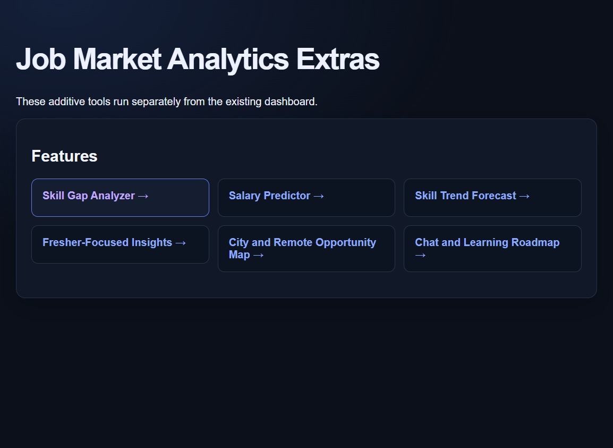
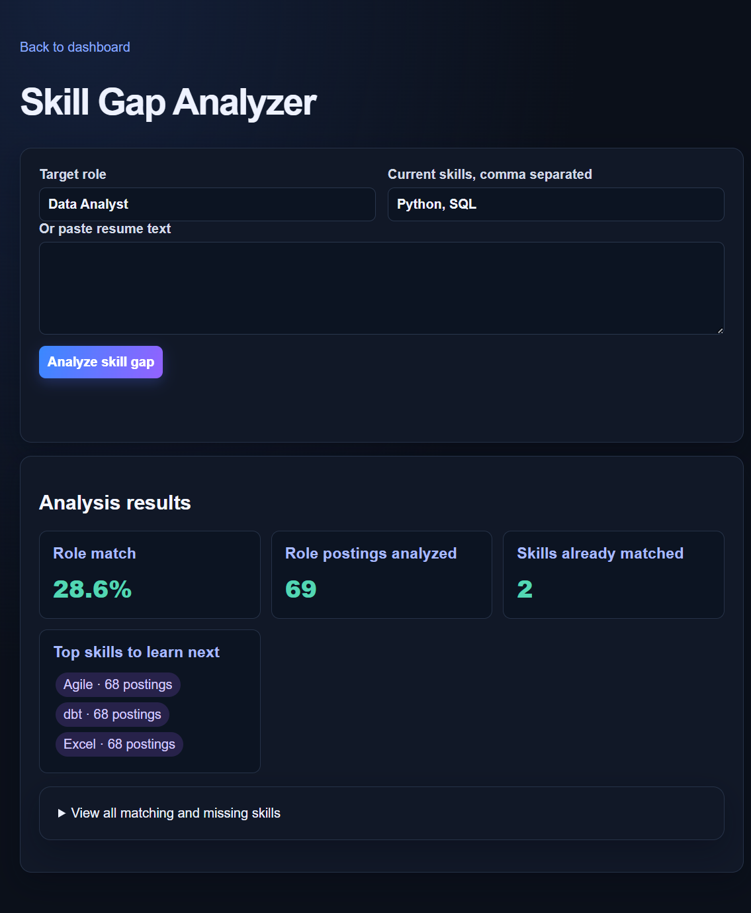
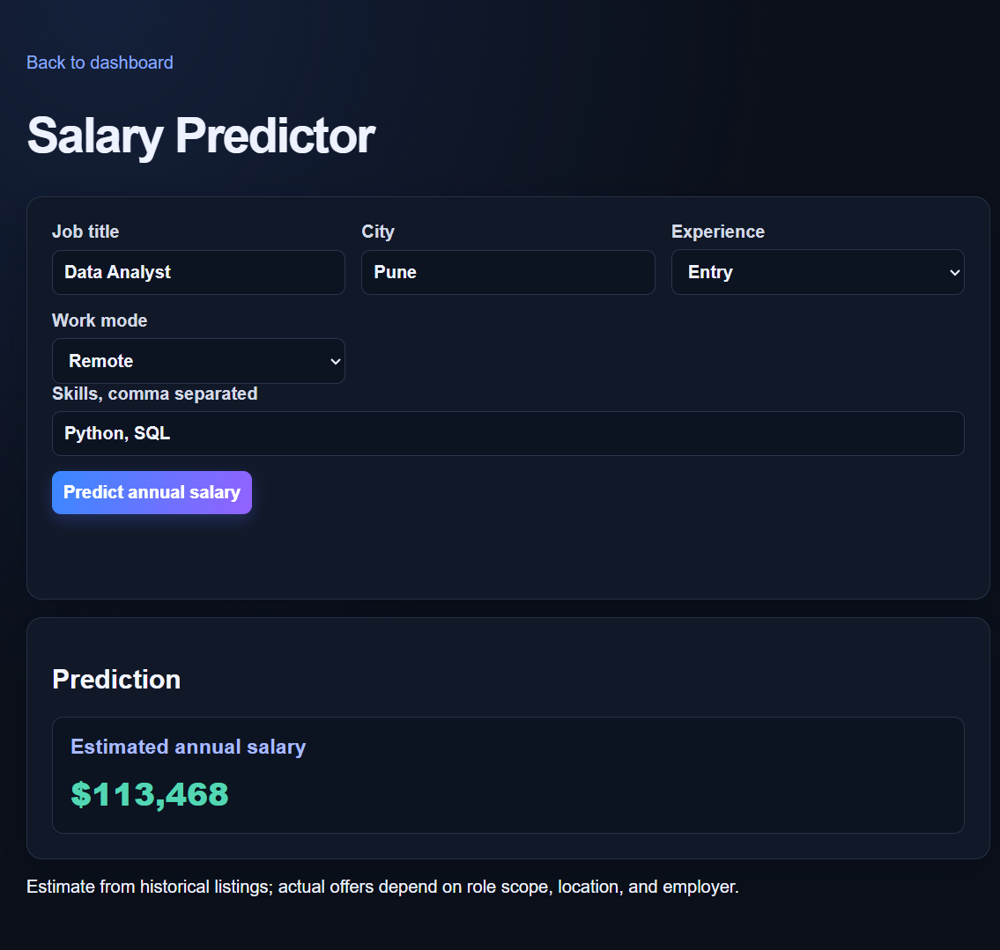
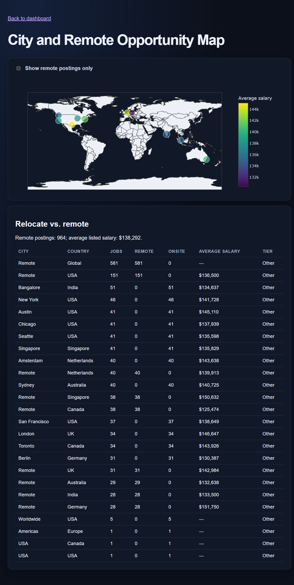

# Job Market Analytics Extras

The extras are additive features integrated into the existing FastAPI
application and dashboard. They share the dashboard's database and origin.

## Run locally

From the repository root:

```powershell
python -m pip install -r requirements-extras.txt
python -m uvicorn api.main:app --host 127.0.0.1 --port 8000
```

Open [http://127.0.0.1:8000/](http://127.0.0.1:8000/) and use the puzzle-piece
button in the header to open the extras page. You can also go directly to
[/static/extras/index.html](http://127.0.0.1:8000/static/extras/index.html).
Each extras page has a home icon that returns to the main dashboard.
The API schema is available at [http://127.0.0.1:8000/docs](http://127.0.0.1:8000/docs).

## Features

| Feature | Page | API |
|---|---|---|
| Skill gap analysis | `/static/extras/skill_gap.html` | `POST /extras/skill-gap` |
| Salary prediction | `/static/extras/salary_predictor.html` | `POST /extras/salary/predict` |
| Skill demand trends | `/static/extras/trend_forecast.html` | `GET /extras/trends` |
| Fresher insights | `/static/extras/fresher_insights.html` | `GET /extras/fresher-insights` |
| City and remote opportunities | `/static/extras/city_map.html` | `GET /extras/cities` |
| Text-to-SQL chat and learning roadmap | `/static/extras/chat.html` | `POST /extras/chat` |

Salary prediction trains and caches a model in the ignored `models/` directory
when no model is present. Forecasting reports a clear message when the database
does not yet contain six distinct months of posting history.

## Result previews

These screenshots were captured from the running extras app using the local job
market database.

### Extras home



### Skill gap analysis



### Salary prediction



### City and remote opportunities



## Tests

Run the feature tests (and the existing platform tests) from the repository root:

```powershell
python -m pytest -q tests/extras tests/test_platform.py
```
